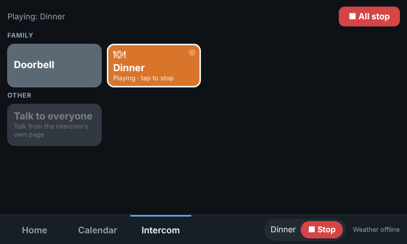
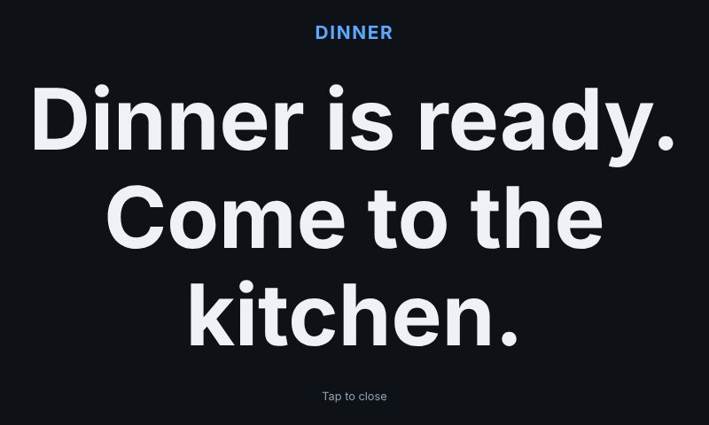

# TouchFrame

A home dashboard for the Raspberry Pi Touch Display (7", 800×480): the time, weather and calendar, and a panel for the [mcast intercom](https://github.com/nathanbent/mcast-tools). It's [InkFrame](https://github.com/nathanbent/InkFrame)'s weather and calendar on a screen that updates live and can be touched.


| Tab | |
| --- | --- |
| **Home** | The time and date, the weather now, the next 8 hours, the next 4 days, and what's coming up on the calendar |
| **Calendar** | This month, and the next 7 days of events |
| **Intercom** | A button for each announcement on the intercom panel. Shown when `[intercom]` is set |

The screen goes back to Home after two minutes untouched.

## How it works

A small Python server on the Pi fetches the weather (Open-Meteo, no key needed) and the calendars, and serves a web page. Chromium shows that page full screen. The page scales with the screen, so it also works on a bigger display or in a browser on another computer.

## Install

Use Raspberry Pi OS with the desktop, set to log in automatically (the default). Then:

```bash
git clone <this repo> ~/touchframe
```

```bash
cd ~/touchframe && ./install.sh
```

```bash
nano config.toml
```

```bash
sudo systemctl start touchframe
```

Reboot, and the dashboard opens full screen. `install.sh` makes a Python environment in `.venv`, copies `config.example.toml` to `config.toml`, installs a service that starts on boot, and adds `kiosk.sh` to the desktop's autostart.

`[weather]` and `[calendar]` in `config.toml` take the same settings as InkFrame's, so those sections can be copied across.

## Intercom



On the intercom panel, make an **operator** access token (Settings → Access tokens) and put it in `config.toml`:

```toml
[intercom]
url = "https://pager.local:8651"
token = "mci_..."
ca_file = "/home/nathan/touchframe/intercom-cert.pem"
```

- If the panel runs on this same Pi, use `url = "http://127.0.0.1:8651"` and leave `ca_file` out.
- A panel on another machine serves HTTPS with a self-signed certificate. Copy its `intercom-cert.pem` (beside its `intercom.json`) to this Pi and name it in `ca_file`. The `url` must use a name the certificate has: the panel's host name, `NAME.local` or its address.

What the tab does:

- **Buttons** follow the panel's own groups, order, colours and icons, and change when the panel is edited. Tap one to play it; tap it again, or *Stop* in the bottom bar, to stop it. Announcements set to ask first, and emergency ones, ask before playing.
- **Text pages** take over the whole screen in large type as the playlist reaches them, whichever tab is showing, and come down when the panel says so. Tap one to close it early. `zones = ["kitchen"]` shows only pages sent to those zones.
- **What's playing** is in the bottom bar on every tab.
- `categories = ["family"]` shows only those groups' buttons. To make sure this screen can only *play* some announcements, limit the token to those categories on the panel.

The token stays in the server on the Pi. The page never sees it.



**Push to talk is not here yet.** Live announcements are shown but can't be pressed. The panel only lets its own page open the microphone connection, and it refuses to be embedded in another page, so this needs a change in mcast-tools first.

To make the Pi a speaker as well, run `mcast receive` on it as described in the mcast-tools README. That's separate from this program.

## Screen brightness

```toml
[screen]
dim_hours = [22, 7]
dim_brightness = 10
```

dims the backlight from 22:00 to 07:00. A touch, or a text page going up, brings it back to full for a minute. `install.sh` adds a udev rule that lets the `video` group set the backlight; log out and in (or reboot) after installing so the group applies.

## Running by hand

```bash
.venv/bin/python -m touchframe --config config.toml -v
```

Then open <http://127.0.0.1:8660/>. To reach it from another computer, set `listen = "0.0.0.0:8660"` under `[app]`. There's no sign-in, so anyone on the network can then see the calendar and press the intercom's buttons.

## Logs

```bash
journalctl -u touchframe -f
```

The last weather and calendar data are kept in `~/.local/state/touchframe`, and used when the network is down ("Weather offline" in the corner).

## Layout

```
touchframe/
  server.py     the web server and its JSON API
  weather.py    Open-Meteo forecast
  agenda.py     events from iCal links
  intercom.py   the link to the mcast intercom panel
  screen.py     backlight dimming
  web/          the page (index.html, app.css, app.js)
```
