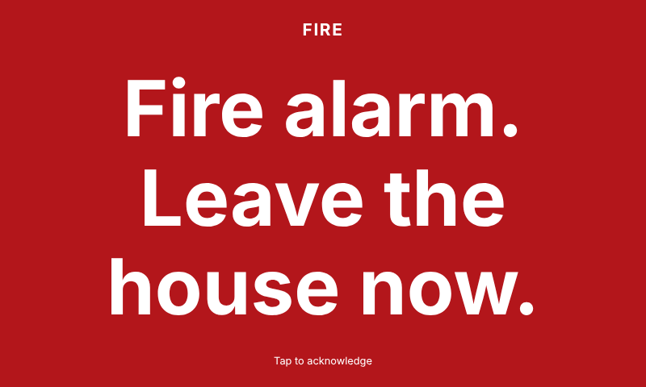

# TouchFrame

A home dashboard for the Raspberry Pi Touch Display (7", 800×480): the time, weather and calendar, and text alerts and buttons for the [mcast intercom](https://github.com/nathanbent/mcast-tools). It's [InkFrame](https://github.com/nathanbent/InkFrame)'s weather and calendar on a screen that updates live and can be touched.


| Tab | |
| --- | --- |
| **Home** | The time and date, the weather now, the next 8 hours, the next 4 days, and what's coming up on the calendar |
| **Calendar** | This month, and the next 7 days of events |
| **Alerts** | Text pages from the intercom, as they arrive and afterwards |
| **Intercom** | A button for each announcement on the intercom panel. Shown when `[intercom]` is set |

The screen goes back to Home after two minutes untouched.

## How it works

A small Python server on the Pi fetches the weather (Open-Meteo, no key needed) and the calendars, and serves a web page. Chromium shows that page full screen. The page scales with the screen, so it also works on a bigger display or in a browser on another computer.

## Install

Use Raspberry Pi OS with the desktop, set to log in automatically (the default). Then:

```bash
git clone <this repo> ~/touchframe
```

```bash
cd ~/touchframe && ./install.sh
```

```bash
nano config.toml
```

```bash
sudo systemctl start touchframe
```

Reboot, and the dashboard opens full screen. `install.sh` makes a Python environment in `.venv`, copies `config.example.toml` to `config.toml`, installs a service that starts on boot, and adds `kiosk.sh` to the desktop's autostart.

`[weather]` and `[calendar]` in `config.toml` take the same settings as InkFrame's, so those sections can be copied across.

## Intercom


On the intercom panel, make an **operator** access token (Settings → Access tokens) and put it in `config.toml`:

```toml
[intercom]
url = "https://pager.local:8651"
token = "mci_..."
ca_file = "/home/nathan/touchframe/intercom-cert.pem"
```

- If the panel runs on this same Pi, use `url = "http://127.0.0.1:8651"` and leave `ca_file` out.
- A panel on another machine serves HTTPS with a self-signed certificate. Copy its `intercom-cert.pem` (beside its `intercom.json`) to this Pi and name it in `ca_file`. The `url` must use a name the certificate has: the panel's host name, `NAME.local` or its address.

What the tab does:

- **Buttons** follow the panel's own groups, order, colours and icons, and change when the panel is edited. Tap one to play it; tap it again, or *Stop* in the bottom bar, to stop it. Announcements set to ask first, and emergency ones, ask before playing.
- **Text pages** show as alerts (below).
- **What's playing** is in the bottom bar on every tab.
- `buttons = false` makes the screen **receive only**: text pages still take it over, but there is no Intercom tab and nothing can be played or stopped from it.
- `categories = ["family"]` shows only those groups' buttons. To make sure this screen can only *play* some announcements, limit the token to those categories on the panel.

The token stays in the server on the Pi. The page never sees it.

**Push to talk is not here.** Live announcements are shown but can't be pressed: the panel only lets its own page open the microphone connection.

## Alerts



A text page takes over the whole screen in large type, whichever tab (or photo) is showing, and flashes once as it goes up. Tap it to close it early.

- **Emergency** pages turn the screen red, keep flashing, and stay up until someone taps them, even after the announcement has ended. One stopped by hand on the panel comes down at once. `emergency_stays = false` under `[alerts]` lets them come down like any other.
- **High** priority pages have an orange heading.
- The **Alerts** tab lists the last 50, newest first, with the time and how each arrived. Its badge counts the ones nobody has tapped or looked at since, so a page that came and went with nobody in the room isn't lost. Opening the tab clears the count. The list is kept across restarts.


Alerts come by two routes, and either works without the other:

### From the panel

With `[intercom]` set, pages come over the panel's API, with the announcement's name and priority, and stay up exactly as long as the panel says. `zones = ["kitchen"]` shows only pages sent to those zones.

### Over multicast

```toml
[multicast]
groups = ["239.192.3.1:11000"]
```

Each group is received by `mcast text recv`, so this needs the `mcast` command from mcast-tools on the Pi:

```bash
curl -fsSL https://github.com/nathanbent/mcast-tools/releases/latest/download/mcast-aarch64-unknown-linux-gnu.tar.gz | sudo tar -xz -C /usr/local/bin mcast
```

On the panel, add the same group to a zone's **Text displays**. Anything else that sends real-time text to the group shows too, for example `mcast text send -g 239.192.3.1:11000 "Bus is here"`.

- The Pi joins the group and reports to the sender over RTCP as `name` (its host name unless set), so it shows up as a receiver on the mcast monitor.
- A channel carries only the words, so a page from one is headed with the sender's name, stays up for `hold_seconds`, and is an emergency only if it has one of `emergency_words`.
- With both routes set, the same page arriving both ways is shown once, and the Alerts tab says it came "via panel · via multicast 239.192.3.1:11000". A page that lists only one of them didn't arrive by the other, which is the thing to look for when testing the network.
- The Alerts tab shows each group, whether it's being listened to, and how many pages it has heard.

## Screensaver

After 5 minutes untouched, photos from `~/Pictures/touchframe` (subfolders too) fill the screen, a new one every 30 seconds in a random order, with the time in the corner. Wikimedia Commons' Picture of the Day is added to them, with its caption. A tap brings the dashboard back, and an alert shows over the photos.

```bash
scp *.jpg nathan@<pi-address>:~/Pictures/touchframe/
```

JPEG, PNG, WebP and GIF work. Photos are scaled down the first time they're shown, so big ones from a phone are fine. With no photos and `picture_of_the_day = false`, the dashboard just stays up. Settings are under `[screensaver]`.

## Screen brightness

```toml
[screen]
dim_hours = [22, 7]
dim_brightness = 10
```

dims the backlight from 22:00 to 07:00. A touch, or a text page going up, brings it back to full for a minute. `install.sh` adds a udev rule that lets the `video` group set the backlight; log out and in (or reboot) after installing so the group applies.

## Running by hand

```bash
.venv/bin/python -m touchframe --config config.toml -v
```

Then open <http://127.0.0.1:8660/>. To reach it from another computer, set `listen = "0.0.0.0:8660"` under `[app]`. There's no sign-in, so anyone on the network can then see the calendar and press the intercom's buttons.

## Logs

```bash
journalctl -u touchframe -f
```

The last weather and calendar data are kept in `~/.local/state/touchframe`, and used when the network is down ("Weather offline" in the corner).

## Layout

```
touchframe/
  server.py     the web server and its JSON API
  weather.py    Open-Meteo forecast
  agenda.py     events from iCal links
  intercom.py   the link to the mcast intercom panel
  multicast.py  text pages from multicast groups, by `mcast text recv`
  alerts.py     the alerts on screen, and their history
  photos.py     the screensaver's photos
  screen.py     backlight dimming
  web/          the page (index.html, app.css, app.js)
```
